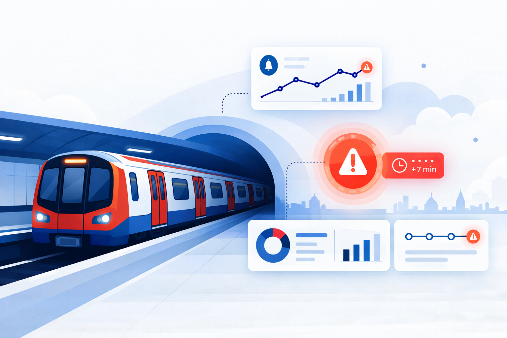
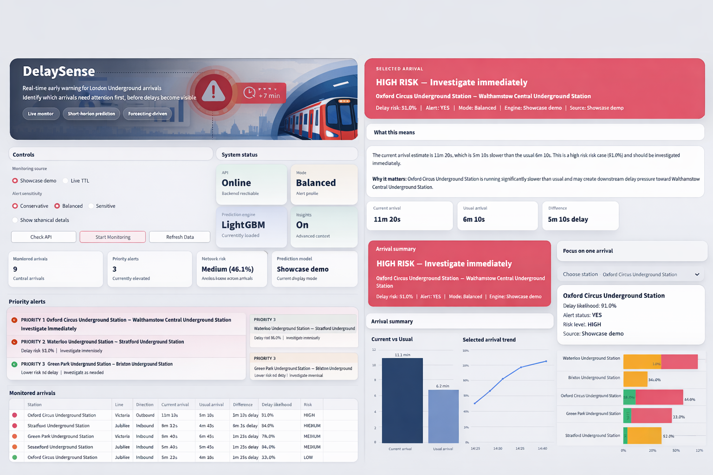
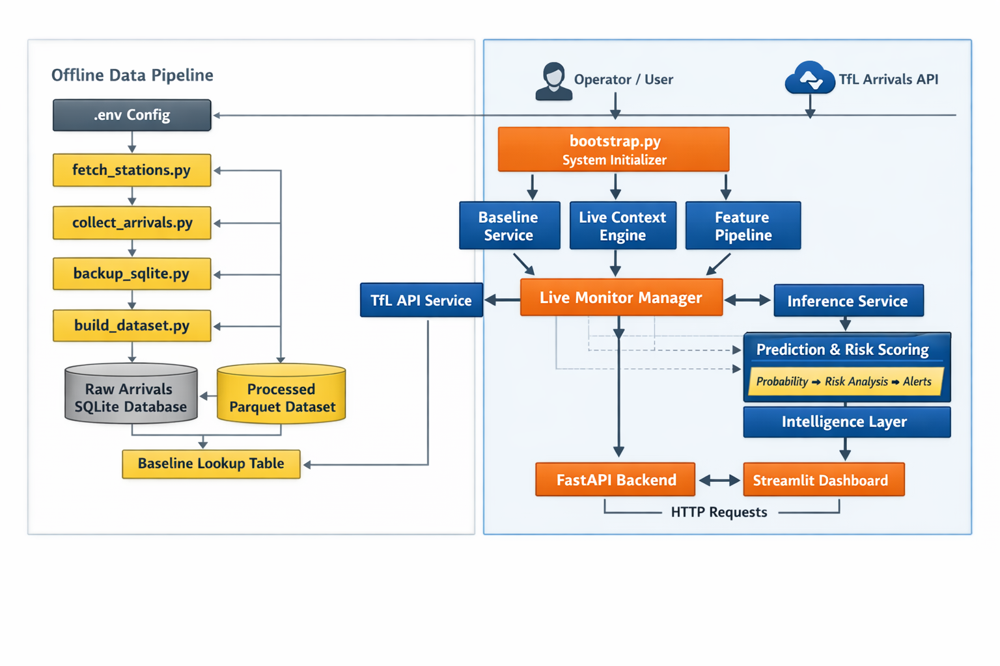

<p align="center">
  
</p>

<h1 align="center">DelaySense</h1>

<p align="center">
  <strong>A real-time early-warning system for London Underground delay risk.</strong><br>
  Instead of reporting when a train arrives, DelaySense predicts which arrivals are about to go wrong.
</p>

<p align="center">
  <a href="https://delaysense-transit-intelligence.streamlit.app/"></a>
  <a href="https://delaysense-transit-intelligence.onrender.com/docs"></a>
  <a href="https://delaysense-transit-intelligence.onrender.com/health"></a>
  
  
  
  
</p>

---

## Table of Contents

- [Overview](#overview)
- [Live Deployment](#live-deployment)
- [The Problem](#the-problem)
- [Approach](#approach)
- [System Architecture](#system-architecture)
- [Repository Layout](#repository-layout)
- [Data Pipeline](#data-pipeline)
- [Feature Specification](#feature-specification)
- [Modeling](#modeling)
- [Inference Runtime](#inference-runtime)
- [API Reference](#api-reference)
- [Dashboard](#dashboard)
- [Getting Started](#getting-started)
- [Configuration Reference](#configuration-reference)
- [Continuous Integration](#continuous-integration)
- [Engineering Notes and Known Limitations](#engineering-notes-and-known-limitations)
- [Roadmap](#roadmap)
- [Team](#team)
- [License](#license)

---

## Overview

DelaySense is a deployed, end-to-end machine learning system that scores live London Underground
arrivals for **short-horizon delay risk**. For every arrival currently visible on the network it
emits a calibrated probability that the arrival will be abnormally late a few minutes from now,
along with the contextual evidence behind that score.

The project spans the full lifecycle — live data ingestion, time-aware feature engineering,
model training and selection, artifact packaging, a serving API, and an operator-facing dashboard —
and runs in public cloud infrastructure rather than only as a local prototype.

**Scope of the current deployment:** the Victoria and Jubilee lines, across five monitored
stations (Oxford Circus, Green Park, Brixton, Waterloo, Stratford), at a 300-second forecast horizon.

<p align="center">
  
  <br><em>The DelaySense monitoring dashboard</em>
</p>

---

## Live Deployment

| Component | Platform | URL |
| --- | --- | --- |
| Dashboard | Streamlit Community Cloud | https://delaysense-transit-intelligence.streamlit.app/ |
| Backend API | Render | https://delaysense-transit-intelligence.onrender.com/ |
| Interactive API docs | FastAPI / Swagger | https://delaysense-transit-intelligence.onrender.com/docs |
| Health and model status | — | https://delaysense-transit-intelligence.onrender.com/health |

The backend runs on a free Render tier and may cold-start on first request. The dashboard reads
the backend over HTTP, so the two tiers scale and deploy independently.

---

## The Problem

Transport for London publishes arrival predictions of the form *"train arrives in 5 minutes."*
That number is accurate but contextless. It does not answer the questions an operator or a
passenger actually has:

- Is five minutes **normal** for this platform, at this hour, on this day?
- Is the situation **trending worse** over the last few minutes?
- Of everything on the board right now, **what should be watched first**?

Existing passenger information systems describe the present. They do not warn that an arrival
which currently looks unremarkable is about to deteriorate.

DelaySense closes that gap by converting raw arrival predictions into a prioritised, forward-looking
risk signal.

---

## Approach

### Forecasting, not classification of the present

Given the feature vector `X_t` observed at time `t`, the model estimates

```
P( arrival is abnormally late at t + H | X_t )     with H = 300 seconds
```

"Abnormally late" is defined relative to a learned norm rather than a timetable:

```
deviation_from_baseline = time_to_station - baseline_median_tts(stop, line, direction, hour, weekday)
label                   = deviation_from_baseline > threshold
```

The baseline is the median historical `time_to_station` for the exact
`(stop, line, direction, hour, weekday)` bucket. Comparing against it removes structural
time-of-day and day-of-week effects, so the label captures genuine anomaly rather than rush hour.

### Why the framing matters

The first iteration of this project modelled delay as classification on **current** data. Because
`deviation_from_baseline` is the quantity the label is derived from, the models learned a
threshold rule and reported near-perfect scores that carried no predictive value — textbook target
leakage.

Reframing the task as forward-looking forecasting (predict the label at `t + H` from features at `t`)
made the problem non-trivial, made the current deviation a legitimate input rather than a giveaway,
and produced a system that is actually useful operationally. This pivot is the central modeling
decision in the project and is documented in
[`docs/Ml_contract_DelaySense.md`](docs/Ml_contract_DelaySense.md) as "Path B".

### Leakage discipline in evaluation

- Baseline medians are computed on the **training window only** and applied unchanged to
  validation and test splits.
- Splits are strictly **chronological** — train on the past, evaluate on the future.
- The baseline lookup table is persisted as an artifact so training and inference consume
  byte-identical values.

---

## System Architecture

<p align="center">
  
</p>

The system is organised in five layers.

| Layer | Responsibility | Implementation |
| --- | --- | --- |
| **1. Live data** | Poll the TfL StopPoint Arrivals API every 30 s; normalise and filter to in-scope lines | [`app/services/tfl_api_service.py`](app/services/tfl_api_service.py), [`scripts/collect_arrivals.py`](scripts/collect_arrivals.py) |
| **2. Historical data** | Raw snapshots in SQLite; safe backups; conversion to Parquet training sets | [`scripts/backup_sqlite.py`](scripts/backup_sqlite.py), [`scripts/build_dataset.py`](scripts/build_dataset.py) |
| **3. Context** | 10-minute in-memory rolling statistics plus baseline lookup | [`rolling_cache.py`](app/services/rolling_cache.py), [`baseline_service.py`](app/services/baseline_service.py), [`feature_pipeline.py`](app/services/feature_pipeline.py) |
| **4. Inference** | Metadata-aware artifact loading, probability scoring, risk banding | [`artifact_loader.py`](app/services/artifact_loader.py), [`inference_service.py`](app/services/inference_service.py) |
| **5. Product** | Serving API, background monitor, operator dashboard | [`app/api/main.py`](app/api/main.py), [`live_monitor_manager.py`](app/services/live_monitor_manager.py), [`app/ui/streamlit_app.py`](app/ui/streamlit_app.py) |

### Offline path — data to model

```
TfL Arrivals API  ──▶  collector  ──▶  SQLite (raw_arrivals)
                                            │
                                   Connection.backup() snapshot
                                            │
                                            ▼
                                    dataset builder
                            rolling stats · baseline medians · labels
                                            │
                       ┌────────────────────┴────────────────────┐
                       ▼                                         ▼
              dataset_*.parquet                        baseline_table_*.parquet
                       │                                         │
                       ▼                                         │
        training with chronological split                        │
        (PR-AUC · ROC-AUC · calibration)                         │
                       │                                         │
                       ▼                                         │
            model artifact (.joblib) ────────────────────────────┘
                                       both shipped to the runtime
```

### Online path — request to prediction

```
dashboard / API client
        │
        ▼
live TfL arrivals fetch  ──▶  normalised snapshot rows
        │
        ├──▶  rolling cache        (in-memory, last 10 min, keyed by vehicle+stop+direction+destination)
        └──▶  baseline lookup      (Parquet artifact, keyed by stop+line+direction+hour+weekday)
        │
        ▼
feature vector X_t  ──▶  loaded artifact .predict_proba  ──▶  P(late)
        │
        ▼
risk band · alert flag · plain-language explanation · optional intelligence payload
```

---

## Repository Layout

```
app/
├── api/main.py               FastAPI application: routes, CORS, lifespan-managed monitor
├── bootstrap.py              Dependency wiring, artifact loading, startup smoke test
├── config/settings.py        Active model path, feature contract, alert thresholds
├── models/                   Deployable model artifacts (6 variants)
├── artifacts/                Runtime artifacts: baseline_table.parquet, model.joblib
├── services/                 Feature pipeline, inference, intelligence, TfL client, monitor
└── ui/streamlit_app.py       Operator dashboard

scripts/                      Data collection, SQLite backup, dataset construction
notebooks/                    EDA, baseline modeling, horizon and target comparison
modeling/                     Artifact validation utility
data/                         Sample data and processed Parquet datasets
docs/                         Architecture guide, ML handoff contract, release notes
images/                       Architecture and dashboard figures
.github/workflows/            CI and project-board automation
```

### Key documents

| Document | Contents |
| --- | --- |
| [`docs/project_overview.md`](docs/project_overview.md) | Full architecture and implementation guide, data dictionary, ML methodology |
| [`docs/Ml_contract_DelaySense.md`](docs/Ml_contract_DelaySense.md) | Model handoff contract between the modeling and deployment layers |
| [`docs/repository_architecture.md`](docs/repository_architecture.md) | Module responsibilities and boundaries |
| [`docs/file_dependency_map.md`](docs/file_dependency_map.md) | Import and dependency graph |
| [`docs/release_v1.0.0.md`](docs/release_v1.0.0.md) | v1.0.0 release notes and known limitations |

---

## Data Pipeline

### Unit of observation

**One row is one API snapshot of one arrival prediction — not one train trip.** TfL revises its
estimate for the same vehicle on every poll, so the same arrival appears repeatedly over time as
its estimate changes. This is why `roll_count_10m` reaches values far above the number of physical
trains, and it must be kept in mind when interpreting any per-row aggregate.

### Collection

```bash
python scripts/collect_arrivals.py
```

Polls `StopPoint/{id}/Arrivals`, filters to the Victoria and Jubilee lines, and appends normalised
rows plus the raw JSON payload to SQLite. Poll interval is set by `POLL_SECONDS`.

### Snapshot safety

The collector writes continuously while the dataset builder reads. Copying the live database file
during collection corrupted it early in the project. The fix, now standard practice in this repo:

```bash
python scripts/backup_sqlite.py
```

This uses `sqlite3.Connection.backup()` with retries to produce a consistent read-only snapshot.
**The dataset builder reads only from a snapshot, never from the live database.**

### Dataset construction

```bash
python scripts/build_dataset.py
```

Steps performed, in order:

1. Slice the snapshot to a development window (`DEV_HOURS`, default 192 h ≈ 8 days).
2. Parse and clean types; drop rows lacking a timestamp, stop, line, or `time_to_station`.
3. Derive time features (`hour`, `weekday`, `is_weekend`).
4. Sort chronologically within `(stop_id, line_id, direction)` and compute 10-minute rolling
   statistics via `groupby().rolling(on=observed_at)`.
5. Build the baseline median table over `(stop_id, line_id, direction, hour, weekday)` and join it back.
6. Compute `deviation_from_baseline` and the threshold labels.
7. Write two artifacts: the ML dataset and the baseline lookup table.

Both are emitted as Parquet for columnar read performance. The full dataset is **not** committed —
raw collection grows at roughly **7 GB/day** (~22 GB after three days), which is why development
proceeded through progressively larger windows (6 h → 12 h → 24 h → 48 h → full week) and why only
`data/sample_data.parquet` is version-controlled. See [`data/README.md`](data/README.md).

---

## Feature Specification

The deployed model consumes exactly nine features, in this order
([`app/config/settings.py`](app/config/settings.py)):

### Temporal context

| Feature | Type | Description |
| --- | --- | --- |
| `hour` | int | Hour of day, 0–23; captures circadian demand patterns |
| `weekday` | int | Day of week, 0 = Monday |
| `is_weekend` | int | 1 for Saturday and Sunday |

### Current state

| Feature | Type | Description |
| --- | --- | --- |
| `time_to_station` | float | Seconds until arrival, as predicted by TfL — the primary raw signal |

### Short-term memory (10-minute rolling window)

| Feature | Type | Description |
| --- | --- | --- |
| `roll_mean_tts_10m` | float | Mean `time_to_station` in the window; the local level |
| `roll_max_tts_10m` | float | Maximum in the window; recent spikes |
| `roll_count_10m` | int | Observation count; activity and data-density indicator |

### Historical norm

| Feature | Type | Description |
| --- | --- | --- |
| `baseline_median_tts` | float | Median `time_to_station` for this `(stop, line, direction, hour, weekday)` bucket |
| `deviation_from_baseline` | float | `time_to_station - baseline_median_tts`. Positive = slower than usual |

Offline, rolling windows are computed with pandas over the full sorted history. Online, the same
statistics come from an in-memory cache keyed by
`(vehicle_id, stop_id, direction, destination_name)` that retains only the last ten minutes and
evicts on every write ([`rolling_cache.py`](app/services/rolling_cache.py)). Baselines are never
recomputed at request time — they are read from the shipped Parquet table.

### Baseline fallback hierarchy

A short collection window leaves some `(stop, line, direction, hour, weekday)` buckets empty.
Rather than emitting a null feature, [`baseline_service.py`](app/services/baseline_service.py)
degrades progressively to the most specific bucket that has data:

| Order | Lookup key | Aggregation |
| --- | --- | --- |
| 1 | stop + line + direction + hour + weekday | exact bucket |
| 2 | stop + line + direction + hour | median across weekdays |
| 3 | stop + line + direction | median across all times |
| 4 | line | median across the line |
| 5 | — | hard default of 300 s |

This keeps the feature vector complete for any live arrival, including stations or hours the
training window never covered.

---

## Modeling

### Method

Feature-based supervised time-series classification. Deliberately **not** ARIMA, Prophet, or an
LSTM: with roughly a week of history, a feature-based gradient-boosted classifier is more robust,
faster to evaluate, more interpretable, and directly actionable as a risk score. Binary
classification was chosen over delay-seconds regression for the same reasons — it is stable on a
short horizon and maps cleanly onto an operational decision.

### Candidates evaluated

Logistic Regression → Random Forest → **LightGBM** → XGBoost, compared on average precision,
ROC-AUC, and log loss against a stratified dummy baseline, with threshold sweeps to select
operating points. Two label thresholds (60 s and 180 s deviation) are compared directly in
[`notebooks/02_horizon_target_comparison.ipynb`](notebooks/02_horizon_target_comparison.ipynb).

Notebooks are committed without stored outputs; re-execute them to reproduce the metric tables.

### Deployed artifact

```
app/models/lightgbm_v2_h300_balanced.joblib
```

Six artifacts ship with the repository — LightGBM v2 and XGBoost, each in conservative, balanced,
and sensitive variants. The active one is a single constant in
[`app/config/settings.py`](app/config/settings.py), so switching models is a one-line change.

Under the handoff contract every artifact carries its model family, version, target name
(`future_late_3min_300s`), horizon, feature order, expected input type (DataFrame or array),
positive class index, and recommended threshold. The runtime reads that metadata rather than
assuming any of it — see [Inference Runtime](#inference-runtime).

### Alert sensitivity modes

Thresholding is applied in the application, not baked into the model, so one probability output
serves all three operating postures:

| Mode | Alert at | High risk | Medium risk | Intended use |
| --- | --- | --- | --- | --- |
| Conservative | 0.80 | ≥ 0.80 | ≥ 0.50 | Minimise false alarms |
| **Balanced** (default) | 0.60 | ≥ 0.70 | ≥ 0.35 | General monitoring |
| Sensitive | 0.40 | ≥ 0.60 | ≥ 0.25 | Maximise early detection |

### Artifact validation

```bash
python modeling/validate_model_artifact.py <model_path>
```

Checks a candidate artifact against the deployment contract — feature order, input type,
`predict_proba` support, class ordering — before it reaches the runtime.

---

## Inference Runtime

### Startup

[`app/bootstrap.py`](app/bootstrap.py) wires the object graph once at import time:

1. Load the baseline table and construct the rolling cache and feature pipeline.
2. Load the model artifact and extract its metadata; **fall back to a mock model** if the artifact
   is missing or fails to load, so the service still starts and reports `model_source: "mock"`
   at `/health` instead of crashing.
3. Run a **smoke test** — build a zero-valued row in the artifact's declared input type, call
   `predict_proba`, and index the declared positive class. A failure here raises at startup rather
   than surfacing as a 500 on the first real request.
4. Optionally initialise the intelligence layer, which degrades gracefully to disabled if
   `data/data.parquet` is absent.
5. Start the background live monitor.

### Prediction path

[`InferenceService.predict`](app/services/inference_service.py) resolves the alert mode, builds
features, constructs the model input **in the artifact's declared type and column order**,
extracts the positive-class probability at the declared index, assigns a risk band, evaluates
the alert flag, and generates a plain-language explanation. Missing required features raise
explicitly rather than silently producing a wrong-shaped input.

### Background monitor

[`LiveMonitorManager`](app/services/live_monitor_manager.py) runs on the FastAPI lifespan, polling
the monitored stations every 30 seconds (up to three arrivals per stop) and scoring them into a
cached result set. Dashboard requests read that cache instead of triggering an outbound TfL call,
which keeps the UI responsive and TfL request volume bounded.

The monitor scores with the intelligence layer **disabled** so that the polling loop stays cheap;
the richer payload is produced on demand by `POST /predict` with
`include_intelligence: true`.

### Warm-up behaviour

Rolling features require history that an in-memory cache does not have at boot. The monitor
therefore reports its own readiness:

| State | Elapsed since start | Meaning |
| --- | --- | --- |
| `cold` | < 3 min | Rolling features are effectively empty; treat scores as provisional |
| `warming` | 3–10 min | Partial context; scores stabilising |
| `warm` | ≥ 10 min | Full 10-minute window available |

This state is exposed at `/health` and `/monitor/status` and surfaced in the dashboard, so a
freshly restarted instance is never mistaken for a confidently quiet network.

### Intelligence layer

Optional and model-agnostic, enabled by `ENABLE_INTELLIGENCE`. Given a probability and its feature
vector it produces a risk classification, a rule-based explanation, a baseline comparison, a rolling
trend summary, retrieval of similar historical cases from the processed dataset, and a
template-generated narrative summary. It is wrapped so that any failure attaches an
`intelligence_error` field to the response rather than failing the prediction.

---

## API Reference

Base URL (production): `https://delaysense-transit-intelligence.onrender.com`

| Method | Path | Purpose |
| --- | --- | --- |
| `GET` | `/` | Service identity and endpoint index |
| `GET` | `/health` | Status, active model info, monitor and warm-up state, monitored stops |
| `GET` | `/sample` | Scored example row — dependency-free smoke test |
| `POST` | `/predict` | Score a single arrival snapshot |
| `GET` | `/monitor/live` | Latest cached scores for all monitored stations |
| `GET` | `/monitor/status` | Monitor thread state, poll interval, warm-up status |
| `POST` | `/monitor/refresh` | Force an immediate poll-and-score cycle |
| `GET` | `/docs` | Interactive OpenAPI documentation |

### `POST /predict`

```jsonc
{
  "observed_at": 1772357400000,       // epoch milliseconds
  "stop_id": "940GZZLUOXC",
  "stop_name": "Oxford Circus",
  "line_id": "victoria",
  "vehicle_id": "vehicle_001",
  "direction": "northbound",
  "platform_name": "Northbound Platform",
  "destination_name": "Walthamstow Central",
  "time_to_station": 660,             // seconds
  "alert_mode": "Balanced",           // Conservative | Balanced | Sensitive
  "include_intelligence": true
}
```

Response:

```jsonc
{
  "prob": 0.78,                       // P(late at t + 300s)
  "risk": "high",                     // low | medium | high, per alert mode
  "alert_flag": true,
  "alert_mode": "Balanced",
  "alert_threshold": 0.6,
  "model_source": "joblib",           // or "mock"
  "model_info": { "model_name": "...", "horizon_seconds": 300, "features": ["..."] },
  "explanation": "Current arrival estimate is 11m, which is 3m 40s slower than the usual 7m 20s. The system flags this as high delay risk.",
  "display":  { "stop_name": "Oxford Circus", "line_id": "victoria" },
  "features": { "time_to_station": 660.0, "deviation_from_baseline": 220.0 },
  "intelligence": { }                 // present when the intelligence layer is enabled
}
```

Cross-origin access is restricted to the origins listed in `CORS_ALLOWED_ORIGINS`.

---

## Dashboard

[`app/ui/streamlit_app.py`](app/ui/streamlit_app.py) is a client of the API — it holds no model and
no feature logic of its own, and talks to the backend over `FRONTEND_API_URL`.

**Capabilities**

- Prioritised table of monitored arrivals ranked by delay likelihood
- Risk banding with alert-mode selection at runtime
- Deep dive on a selected arrival: current estimate, baseline, deviation, rolling trend
- Plain-language explanation of each score, with similar historical cases when available
- Monitor health and warm-up state, so score reliability is always visible
- Collapsible technical panel exposing the raw feature vector and active model metadata

**Two data sources, one code path**

| Mode | Data | Purpose |
| --- | --- | --- |
| Showcase demo | Curated scenarios embedded in the app | Deterministic walkthroughs covering high, medium, and low risk; independent of live API availability |
| Live TfL | Real arrivals via the backend monitor | Actual current network conditions |

Both modes run the identical model and scoring logic — only the data source differs. Live mode can
legitimately look quiet for long stretches; a well-behaved network produces few alerts, which is
precisely why the demo mode exists for presentations.

---

## Getting Started

### Prerequisites

- Python 3.11
- A TfL API key from the [TfL API Portal](https://api-portal.tfl.gov.uk/) — required only for
  data collection, not to run the app against committed artifacts

### Installation

<details open>
<summary><strong>macOS / Linux</strong></summary>

```bash
pyenv local 3.11.3
python -m venv .venv
source .venv/bin/activate
pip install --upgrade pip
pip install -r requirements.txt
```
</details>

<details>
<summary><strong>Windows — PowerShell</strong></summary>

```powershell
pyenv local 3.11.3
python -m venv .venv
.venv\Scripts\Activate.ps1
python -m pip install --upgrade pip
pip install -r requirements.txt
```
</details>

<details>
<summary><strong>Windows — Git Bash</strong></summary>

```bash
pyenv local 3.11.3
python -m venv .venv
source .venv/Scripts/activate
pip install --upgrade pip
pip install -r requirements.txt
```
</details>

`make setup` performs the same steps on POSIX shells.

### Run the stack locally

```bash
# Terminal 1 — backend on :8000
python -m uvicorn app.api.main:app --reload

# Terminal 2 — dashboard on :8501
streamlit run app/ui/streamlit_app.py
```

Verify the backend independently:

```bash
curl http://localhost:8000/health
curl http://localhost:8000/sample
```

`/health` reports whether a real artifact loaded (`model_source: "joblib"`) or the mock fallback is
in use, plus current monitor warm-up state.

### Reproduce the dataset (optional)

```bash
python scripts/collect_arrivals.py          # long-running collector
python scripts/backup_sqlite.py             # consistent snapshot
python scripts/build_dataset.py             # features, labels, baseline table
```

Then open the notebooks in `notebooks/` for EDA, model comparison, and threshold analysis.

---

## Configuration Reference

Create a `.env` in the repository root. All variables have working defaults except the TfL
credentials.

### Application runtime

| Variable | Default | Purpose |
| --- | --- | --- |
| `MODEL_NAME` | `future_late_3min_300s` | Target name reported in responses |
| `DEFAULT_ALERT_MODE` | `Balanced` | Alert mode applied when a request omits one |
| `ENABLE_INTELLIGENCE` | `true` | Toggles the explanation and retrieval layer |
| `FORCE_MOCK_MODEL` | `false` | Bypass artifact loading; useful for CI and UI work |
| `CORS_ALLOWED_ORIGINS` | `http://localhost:8501` | Comma-separated allowed origins |
| `FRONTEND_API_URL` | `http://localhost:8000` | Backend base URL used by the dashboard |

### Data collection and dataset build

| Variable | Default | Purpose |
| --- | --- | --- |
| `TFL_APP_KEY` | — | TfL API key used by the collection scripts |
| `DB_PATH` | `data/raw/tfl_arrivals.sqlite` | SQLite path for collection; snapshot path for the builder |
| `POLL_SECONDS` | `60` | Collector poll interval |
| `DEV_HOURS` | `192` | Size of the development window, in hours |
| `ROLLING_WINDOW` | `10min` | Rolling statistics window |
| `LATE_THRESHOLD_SECONDS` | `60` | Deviation threshold defining the `late` label |
| `INCLUDE_ROLLING_STD` | `0` | Enable rolling standard deviation (expensive) |
| `STOP_LIMIT` | `0` | Restrict to the first N stops; `0` = no limit |
| `OUT_DATASET_PATH` | `data/processed/dataset_192H_60_forecast.parquet` | Dataset output |
| `OUT_BASELINE_PATH` | `data/processed/baseline_table_192H_60_forecast.parquet` | Baseline table output |

The active model path, feature contract, and alert thresholds are code-level constants in
[`app/config/settings.py`](app/config/settings.py) rather than environment variables — they are part
of the deployment contract and are changed intentionally, with a validation run.

---

## Continuous Integration

[`.github/workflows/ci.yml`](.github/workflows/ci.yml) runs on every push and pull request against
`main`:

1. Install dependencies on Python 3.11.
2. Verify `app` and `app.config.settings` import cleanly.
3. Boot the Uvicorn server and assert that `/health` returns success.

This catches the failure modes that matter most for this codebase — broken imports, a missing or
incompatible artifact, and startup-time wiring errors — before deployment. Additional workflows
automate GitHub project-board transitions for issues and pull requests.

---

## Engineering Notes and Known Limitations

**Operational**

- The live monitor needs roughly ten minutes of uptime before rolling features are complete;
  scores before that are reported as `cold` or `warming` and should be read as provisional.
- Live scope is limited to five stations on two lines, configured in
  [`tfl_api_service.py`](app/services/tfl_api_service.py).
- The backend runs on a free Render tier and cold-starts after idle periods.
- The intelligence layer requires a local `data/data.parquet`; without it the service runs
  normally with that layer disabled.

**Data and modeling**

- Training history is about a week, so baseline medians for sparse
  `(stop, line, direction, hour, weekday)` buckets are less stable than a longer collection period
  would give. Sparse buckets are handled at lookup time by the fallback hierarchy below, but a
  fallback value is by construction less specific than a populated bucket.
- Raw collection grows at ~7 GB/day, so the full processed dataset is not version-controlled.
- Notebooks are committed without outputs; metric tables require re-execution.

**Repository state**

- `scripts/build_dataset.py` emits the current-state labels `late` (deviation > 60 s) and
  `late_3min` (deviation > 180 s). The forward-shifted target the deployed artifact was trained on
  (`future_late_3min_300s`) is derived downstream, so the checked-in builder does not by itself
  reproduce the deployed training set despite the `_forecast` suffix in its default output paths.
- `modeling/` retains only the artifact validator; the training workflow now lives in the
  notebooks — see [`modeling/README.md`](modeling/README.md).
- `app/api/routes.py` is an empty placeholder; all routes are defined in `app/api/main.py`.
- `requirements.txt` is UTF-16 encoded, which some tooling mishandles.

---

## Roadmap

- Extend the collection window so fewer baseline buckets rely on fallback aggregation
- Grounded generative alert briefings built from structured evidence, with logging and monitoring
  of generated summaries
- Live disruption and line-status context from official TfL feeds
- Richer explanation and evidence panels, including SHAP-based feature attribution
- Expanded coverage across additional stations and lines
- Latency benchmarking against the documented sub-200 ms inference target

---

## Team

Built as a capstone project at [neuefische](https://www.neuefische.de/) Data Science Bootcamp.

| Contributor |
| --- |
| Mayank Vashistha |
| Peter Furtado |
| Killian Schmiers |

---

## License

Released under the MIT License. See [`LICENSE`](LICENSE).

---

<p align="center">
  <strong>raw transit data → contextual intelligence → actionable insight</strong>
</p>
